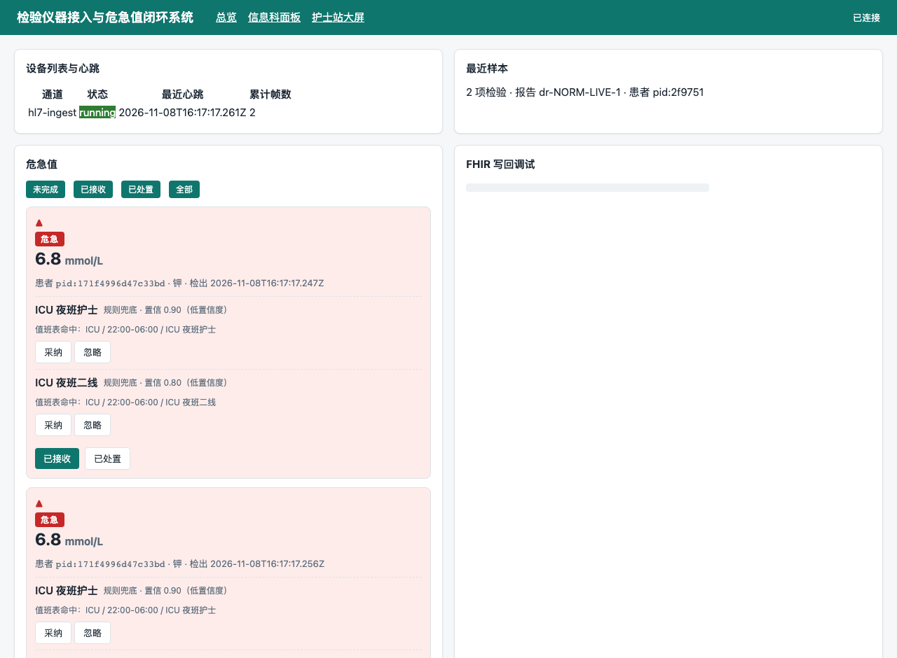
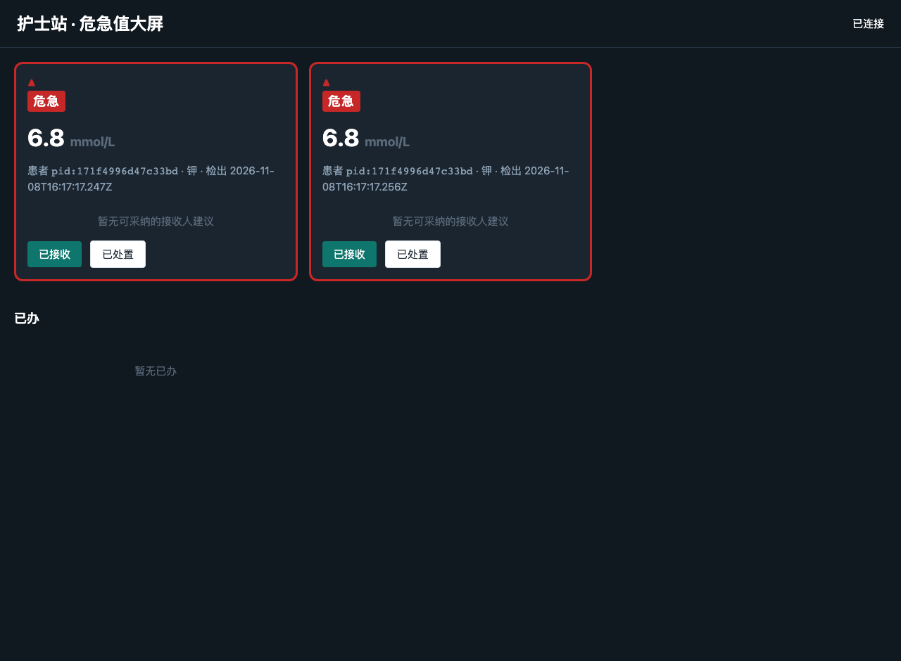
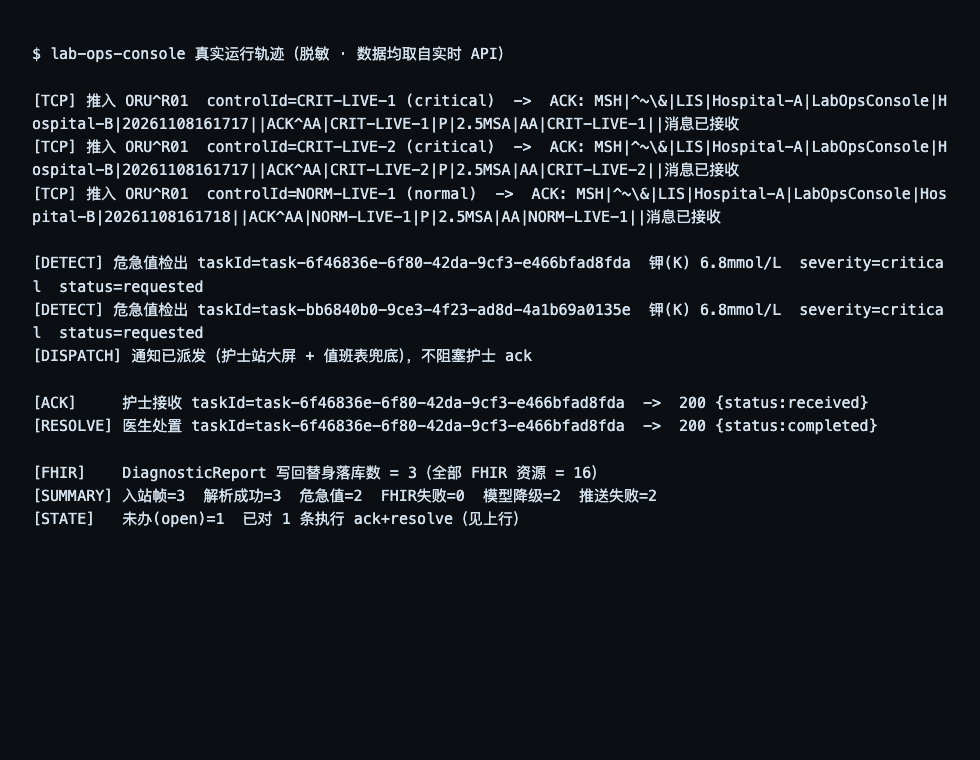

# 检验仪器接入与危急值闭环系统

> 把检验科仪器（生化 / 血细胞 / 免疫 / 血凝）接进院内系统：仪器推来结果 → 自动写成 LIS 可读的检验报告 → 危急值即时亮在护士站大屏 → 接收与处置全程留痕，月底一键导出闭环台账交医务科。

检验科的仪器来自不同年代、不同厂商：有的走 HL7 v2 over TCP，有的发 ASTM E1394 字节流，有的只能读串口，还有的要按厂商手册拆字节。本系统把四种接法收进同一条主路径（改一份 yaml 换仪器，不改代码），并把「危急值通知到了没有、谁接的、怎么处置的」变成可导出的台账，而不是月底补录的 Excel。

## 适用场景 / 目标岗位

| 岗位 | 什么时候用 | 得到什么 |
|------|------------|----------|
| 检验科 LIS 维护工程师 | 接新仪器、改协议、排查某台仪器为什么没数据 | 一份 yaml 描述仪器；解析失败逐条进死信队列并带原因码；每台仪器的心跳与最近一条样本随时可查 |
| 检验技师 | 当班确认仪器推送是否正常 | 每台仪器的实时心跳、最近一条样本、解析成功或失败一眼可见 |
| 病区护士 / 临床医生 | 危急值来了要马上知道并确认 | 护士站大屏亮红框：检验项、数值、单位、检出时间、该通知谁；点「已接收」「已处置」即完成留痕 |
| 医务科 / 质控员 | 月底出闭环台账、飞检前倒查 | 一键导出月度台账；每一次通知、接收、处置、被拒绝的操作都能按时间还原；越权尝试可单独倒查 |
| 信息科 | 通道热重载、写入失败排障、模型不可达兜底 | 通道状态与最近错误码；所有凭据只从环境变量读；模型不可达时系统仍按值班表找到该通知谁 |

## 能力要点

- **四种仪器接法并存**：HL7 v2、ASTM E1394、串口、厂商私有字节协议各走一条通道，配置由 yaml 描述，改完重载即生效，不动代码。
- **结果自动写成院内标准报告**：每条检验项落成一个检验结果，一份报告落成一个报告并关联全部结果，标本与仪器各自留痕；同一份标本重复推送不会产生重复记录。
- **危急值不靠「有没有打标记」**：仪器打了危急标记就采信；没打的，院内阈值表按单位换算后判定，两边冲突时取更严重的一侧并记账。
- **护士站大屏 30 秒内亮红框**：浏览器大屏与信息科面板同一端口，护士点「已接收」「已处置」直接推进状态并写入审计记录。
- **通知不出去不会丢**：大屏断线自动重连，仍失败则降级到院内消息推送，再失败进补推队列，网络恢复后按序补推。
- **月底不用补录**：台账导出前逐条校验留痕是否齐全，缺一条就拒绝出表并指出是哪一条，不让「事后补录」发生。

## 快速开始

### 依赖

- Node.js **≥ 20**（开发与验证环境实测 v26）
- npm ≥ 10
- 需要原生模块：SQLite 驱动与串口驱动在安装时自动编译（Windows / Linux 需本地编译工具链）

### 安装

```bash
cd lab-ops-console
npm install
```

### 配置

复制示例配置为 `.env` 后按院内实际填写（`.env` 已被忽略，禁止提交）：

```bash
cp .env.example .env
```

完整变量清单见「命令 / API / 配置说明 → 关键配置项」。凭据一律从环境变量读，代码里不写死。

### 构建与验证

```bash
# 类型检查
npm run typecheck

# 单元 + 集成 + 端到端测试
npm test

# 编译产物到 dist/
npm run build

# 启动服务（前台）
npm run cli start

# 验证服务活着
curl -fsS http://127.0.0.1:3000/healthz
```

### 主命令速查

```bash
# 启服务（前台）
node dist/gateway/cli.js start

# 通道状态 + 心跳 + 最近一条样本
node dist/gateway/cli.js status

# 热重载 channels/*.yaml（换仪器不重启服务）
node dist/gateway/cli.js reload

# 导出本月闭环台账
node dist/gateway/cli.js export --start 2026-10-01 --end 2026-10-31 --out ./exports/

# 跑全部测试
npm test
```

## 命令 / API / 配置说明

### 关键配置项

| 配置项 | 默认值 | 说明 |
|--------|--------|------|
| `DEVICE_LISTEN_PORT` | `2575` | HL7 v2 TCP 监听端口；仪器把报文推到这里（必填） |
| `DEVICE_ENCODING` | `utf-8` | 帧编码；可选 `utf-8` / `gbk` / `gb18030`，解析层另有编码探测兜底 |
| `SERIAL_PORT` | 空 | 串口设备路径；未接串口留空 |
| `SERIAL_BAUD_RATE` | `9600` | 串口波特率 |
| `LIS_FHIR_BASE_URL` | （必填） | 院内 LIS 的 FHIR R4 服务地址；检验结果写到这里 |
| `LIS_FHIR_TOKEN` | （必填） | 访问 LIS 的静态令牌；与下面的 OAuth2 凭据二选一 |
| `LIS_FHIR_OAUTH_TOKEN_URL` | 空 | 院内网关的换令牌地址；配了下面两项就自动走「换令牌 → 带令牌写 FHIR」，令牌自动缓存与提前刷新 |
| `LIS_FHIR_OAUTH_CLIENT_ID` | 空 | 院内网关下发的客户端标识 |
| `LIS_FHIR_OAUTH_CLIENT_SECRET` | 空 | 院内网关下发的客户端密钥 |
| `LIS_FHIR_OAUTH_SCOPE` | 空 | 授权范围，例 `system/*.read system/*.write` |
| `FHIR_BASE_URL` | （必填） | 危急值闭环写入的 FHIR R4 端点（处置状态与审计记录） |
| `FHIR_TOKEN` | （必填） | 访问该端点的静态令牌；与下面的 OAuth2 凭据二选一 |
| `FHIR_OAUTH_TOKEN_URL` | 空 | 危急值闭环端点的换令牌地址 |
| `FHIR_OAUTH_CLIENT_ID` | 空 | 客户端标识 |
| `FHIR_OAUTH_CLIENT_SECRET` | 空 | 客户端密钥 |
| `FHIR_OAUTH_SCOPE` | 空 | 授权范围 |
| `NOTIFY_WEBHOOK_URL` | 空 | 大屏推不到时的降级推送地址（院内 IM / OA 消息） |
| `MODELS_BASE_URL` | （必填） | 模型网关地址；仅用于「该通知谁」与字段归因两条辅助路径 |
| `MODELS_API_KEY` | （必填） | 模型网关密钥 |
| `MODELS_MODEL` | `gpt-4o-mini` | 模型名 |
| `MODELS_TIMEOUT_MS` | `8000` | 模型调用超时；超时即降级到值班表规则 |
| `HTTP_PORT` | `3000` | 面板与大屏的 HTTP / WebSocket 同端口 |
| `DATA_DIR` | `./data` | 本地状态与审计链落地目录 |
| `LOG_LEVEL` | `info` | 日志级别 |
| `SHUTDOWN_TIMEOUT_MS` | `10000` | 优雅停机等待时长 |

必填项缺失时启动即失败，并明确指出缺哪个变量，不静默用默认值蒙混过关。

### CLI 子命令 / 接口端点

| 命令或路径 | 用途 | 关键参数 |
|------------|------|----------|
| `node dist/gateway/cli.js start` | 启服务（前台或交给 pm2 守护） | `--daemon` / `--json` |
| `node dist/gateway/cli.js status` | 列通道状态、心跳、最近一条样本 | `--json` |
| `node dist/gateway/cli.js reload` | 热重载 `channels/*.yaml` | `--channel <file>` |
| `node dist/gateway/cli.js export` | 导出闭环台账 | `--start` / `--end` / `--out` / `--format csv\|pdf` |
| `GET /healthz` | 健康检查 | — |
| `GET /` | 信息科面板首屏 | — |
| `GET /critical` | 护士站大屏 | — |
| `GET /fhir-debug` | 写回结果检索小窗 | `?patient=` `?date=` |
| `WS /` | 通道心跳与危急值事件推送 | 浏览器侧自动重连 |

### 错误与降级

| 场景 | 表现 | 处理方式 |
|------|------|----------|
| 写入院内端点返回 5xx | 报「服务端失败」错误码 | 指数退避重试；重试用尽后进死信队列并写审计记录，不丢数据 |
| 写入返回 4xx | 报「数据不合规」错误码 | 不重试，直接进死信队列并写审计记录，指出哪个字段不合规 |
| 模型超时 / 报错 / 返回内容不可解析 | 报对应错误码 | 自动降级到值班表规则，候选标「低置信度」；**不阻塞**主路径，护士照常可以确认处置 |
| 串口断开 / 仪器断电 | 报「串口断开」 | 退避重连；该通道在面板上标为异常，不静默消失 |
| 大屏连接断开 | 报「推送断开」 | 浏览器端指数退避重连；服务端重试后降级到院内消息推送 |
| 某条检验项缺必要字段 | 报「字段缺失」 | 该条单独进死信队列，同批次其余检验项照常处理 |
| 令牌过期 | 报「凭据过期」 | 提前 60 秒自动刷新；服务端返回未授权时再刷新重试一次 |
| 处置状态被跳步或重复确认 | 报「状态非法」 | 拒绝并写一条「被拒绝」的审计记录，可在飞检倒查里单独查出来 |

### 对接现有系统

| 对端 | 协议 | 方向 | 凭据来源 |
|------|------|------|----------|
| 检验仪器（HL7 v2） | TCP + HL7 v2.5 报文 | 入站 | 无（院内网段） |
| 检验仪器（ASTM / 串口 / 私有） | 串口字节流 | 入站 | 无（院内网段） |
| 院内 LIS | FHIR R4 REST + OAuth2 client-credentials | 出站 | `LIS_FHIR_BASE_URL` + `LIS_FHIR_OAUTH_*` 或 `LIS_FHIR_TOKEN`（环境变量） |
| 危急值闭环 FHIR 端点 | FHIR R4 REST + OAuth2 | 出站 | `FHIR_BASE_URL` + `FHIR_OAUTH_*` 或 `FHIR_TOKEN`（环境变量） |
| 院内 IM / OA 消息 | HTTP webhook | 出站（降级用） | `NOTIFY_WEBHOOK_URL`（环境变量） |
| 护士站大屏 / 信息科面板 | WebSocket | 出站（浏览器订阅） | 无（同端口） |

幂等约定：每次写入带上「设备号 + 标本号」构成的幂等标识并要求服务端按此去重，仪器重发或通道重连不会产生重复报告。该标识里的保留字符按 FHIR 检索串规范转义后再送出，标本号带 `|`、`,` 也不会被服务端误拆成两条。

写失败的处理：服务端临时故障（5xx）按 1 秒 / 2 秒 / 4 秒退避重试 3 次，仍失败则把这条标本的原始内容存进本地死信队列（可回放、可核对）；服务端明确拒收（4xx）不重试，但同样留底，检验科那边不会「看不见这份结果」。

## 典型场景

### 场景 1：检验科工程师接一台新仪器

1. 在 `channels/` 复制 `example-private-biochem.yaml` 为 `device-x.yaml`，按仪器手册填起始符、结束符、字段偏移与编码
2. `node dist/gateway/cli.js reload` 热加载，不重启服务，不影响其他仪器
3. `node dist/gateway/cli.js status` 确认新增通道在线、心跳正常
4. 让仪器推一段样本，再看 `status` 里该通道的「最近一条样本」已更新，且死信队列没有新增

### 场景 2：危急值 30 秒内推到大屏并完成处置

1. 仪器推来含危急标记的检验结果（示例：血钾 6.8 mmol/L）
2. 服务识别为危急值并建处置单，同时按院内阈值表复核——仪器没打标记但超危急界值的同样拦下
3. 护士站大屏亮红框：检验项、数值、单位、检出时间、候选接收人
4. 值班护士点「已接收」→ 状态推进到已接收，写入一条留痕（操作人、时间、结果）
5. 医生点「已处置」并写处置备注 → 状态推进到已处置，备注累加进报告留痕

### 场景 3：医务科月底导出闭环台账

1. `node dist/gateway/cli.js export --start 2026-10-01 --end 2026-10-31 --out ./exports/`
2. 打开导出的台账：每个危急值一行，含各状态时间戳、处置备注与留痕条数
3. 导出前会逐行校验留痕字段是否齐全，缺任何一条就拒绝出表并列出缺失的记录号
4. 飞检倒查：查「被拒绝」的审计记录，能看到越权尝试与重复确认

## 输出样例

### 终端输出：通道状态

```
channel                 heartbeat             last_sample_id       errors
example-hl7             2026-10-13T10:23:01Z  ORU^R01-2026-10-13-007   0
example-bytestream      2026-10-13T10:22:58Z  ASTM-007                0
example-private-biochem 2026-10-13T10:22:55Z  PRIV-007                0
```

### 月度闭环台账片段（`exports/close-loop-2026-10.csv`）

| 处置单 | 患者标识 | 检验项 | 最终状态 | 首次留痕 | 最后留痕 | 处置备注 | 留痕条数 |
|--------|----------|--------|----------|----------|----------|----------|----------|
| `crt-001` | `<EXAMPLE_PATIENT>` | 血钾 6.8 | 已处置 | 2026-10-13T10:23:00Z | 2026-10-13T10:25:30Z | 已电话告知 ICU 值班 | 3 |
| `crt-002` | `<EXAMPLE_PATIENT>` | 血糖 2.1 | 已处置 | 2026-10-13T11:02:00Z | 2026-10-13T11:08:15Z | 已补液纠正 | 3 |

### 浏览器面板

信息科面板首屏与护士站大屏的真实运行截图见 `docs/screenshots/`（采集方式见「概念 / 实测对照 → 实测证据」；截图由本轮截图任务补齐）。

## 概念 / 实测对照

### 视觉目标

结构化视觉目标卡见 `docs/concepts/visual-target.md`，含三个状态与配色、版式、信息层级约定：

- **起始态**：打开信息科面板 —— 列出所有已配置仪器通道，每行显示最近心跳（绿/红）、最近一条样本标识、解析成功或失败标记。
- **首个可用瞬间**：仪器推来含三项结果的报文后 1 秒内 —— 对应通道行的心跳与最近样本更新，院内端点收到三条检验结果与一份报告。
- **成形态**：含危急值的报文推来后 —— 护士站大屏亮红框，显示检验项、数值、单位、检出时间与候选接收人；点「已接收」后红框转橙并出现处置备注框，点「已处置」后转入已办列表。

### 实测证据

真实运行截图存放于 `docs/screenshots/`，由采集任务在本地起服务、用脱敏报文跑通完整链路后逐张截取（起 fhir-stub 替身 + 真实 TCP 通道 + 真实 HTTP/WS 网关，再推入脱敏 ORU^R01 报文触发检测、派发与面板亮屏）：



`panel-overview.png` —— 信息科面板首屏：设备通道心跳（累计帧数）、最近一条样本、未处置危急值卡片。



`critical-wallboard.png` —— 护士站大屏：危急值红框卡片，含检验项（钾）、数值（6.8）、单位（mmol/L）、患者脱敏标识与检出时间。



`cli-dispatch-trace.png` —— CLI 终端真实输出：真实 TCP ACK 字节、危急值检出、护士接收与医生处置状态推进、FHIR 写回落库数与运行摘要（数据均取自实时 API）。
> **诚实标注**：上方「视觉目标」是设计意图，下方「实测证据」是真实运行截图。两者在字号、配色、密度上必然有差距，不声称完全一致，也不会用事后效果图抹平差距。截图在本地 macOS headless chromium 截取，字体与最终院内部署环境可能不同。

## 架构与数据流

```
┌──────────────┐  HL7 v2 / ASTM E1394 / 串口 / 厂商私有字节协议
│  检验仪器    │ ─────────────────────────────┐
└──────────────┘                              ▼
                            ┌────────────────────────────────┐
                            │  通道层 channel                │
                            │  HL7 帧切分 / 字节流滑窗匹配    │
                            │  串口读取 / 私有协议字段偏移     │
                            │  yaml 配置 + 限速 + 死信队列    │
                            └───────────────┬────────────────┘
                                            │ 结构化检验结果
                                            ▼
                            ┌────────────────────────────────┐
                            │  解析层 parser                 │
                            │  结果项拆分 / 字段字典映射      │
                            │  编码探测 / 脏数据标记          │
                            └───────────────┬────────────────┘
                                            │ 检验结果 / 报告 / 标本 / 仪器
                                            ▼
                            ┌────────────────────────────────┐
                            │  出站层 fhir                    │
                            │  OAuth2 取令牌 + 幂等去重       │
                            │  契约校验 + 退避重试 + 待传队列  │
                            └───────────────┬────────────────┘
                                            │ 写入成功
                                            ▼
                            ┌────────────────────────────────┐
                            │  危急值层 critical              │
                            │  危急判定（标记 + 阈值表复核）   │
                            │  处置单状态机 + 审计链 + 升级    │
                            └───────┬────────────────┬───────┘
                                    │                │
                       ┌────────────▼──────┐  ┌──────▼─────────────┐
                       │ 派发（多级降级）    │  │ 模型网关（建议）     │
                       │ 大屏 → 消息 → 补推 │  │ 不可达即降级值班表  │
                       └────────────┬──────┘  └────────────────────┘
                                    ▼
                            ┌────────────────────────────────┐
                            │  面板层 gateway（同端口）        │
                            │  信息科面板 / 护士站大屏        │
                            │  WebSocket 实时推送 + HTTP 接口 │
                            └────────────────────────────────┘
```

### 关键不变量

- **幂等写入**：每条写入带「设备号 + 标本号」幂等标识并要求服务端按此去重，重复推送不产生重复报告。
- **状态推进必带留痕**：处置单每次状态变更（含被拒绝的）都写一条留痕记录，不允许无痕推进。
- **留痕四要素非空**：操作人、时间、来源、结果四项缺一即拒绝写入，倒查时不会出现半截记录。
- **失败不静默改数据**：写入失败进死信队列并保留原始字节；通知失败进补推队列；模型失败降级为规则建议并标低置信度，**绝不**自动推进处置状态。
- **逐条隔离**：一条结果解析失败不影响同批次其余结果；一批写入里一行失败不影响其余行。
- **升级不停摆**：处置单停留超时自动升级到科室主任、再到医务科，升级本身也留痕。

## 安全与合规边界

- **不落患者真名与真实住院号**：结果透传进报告，但日志与台账中患者标识以哈希占位出现。
- **不自动签名、不代签**：留痕中的操作人就是实际点按钮的护士或医生，系统不代填、不冒签。
- **不出诊疗建议**：模型只提供「该通知谁」与字段归因两类辅助建议，且不可达时降级为查值班表；不产出诊断、用药或剂量意见。
- **凭据只从环境变量读取**：令牌与密钥不写死在代码、不写进日志、不提交到 Git。
- **令牌不落盘**：访问令牌只在内存中缓存并提前刷新，不写文件、不进数据库。

## 验收与自检

| 验收项 | 命令 | 期望结果 |
|--------|------|----------|
| 依赖安装 | `npm install` | 安装成功，无原生模块编译失败 |
| 类型检查 | `npm run typecheck` | 无错误 |
| 测试套件 | `npm test` | 全部通过，0 失败 |
| 服务启动 | `npm run cli start` 后 `curl -fsS http://127.0.0.1:3000/healthz` | HTTP 200 |
| 通道状态 | `npm run cli status` | 列出通道、心跳与最近一条样本 |
| 新仪器接入 | 写一份通道 yaml → `reload` → 推一段样本 | 该通道出现新样本，其余通道不受影响 |
| 危急值闭环 | 推一条含危急值的报文 → 大屏确认 → 处置 | 处置状态逐级推进，留痕齐全 |
| 非法状态被拒 | 直接跳到「已处置」 | 请求被拒并留下一条「被拒绝」记录 |
| 台账导出 | `npm run cli export --start ... --end ... --out ./exports/` | 导出成功；留痕缺失时拒绝出表并指出记录号 |

## 项目结构

```
lab-ops-console/
├── src/
│   ├── channels/         # 通道层：HL7 帧切分 / 字节流滑窗匹配 / 串口 / 私有协议 / yaml 配置 / 限速 / 死信队列
│   ├── parser/           # 解析层：结果项拆分 / ASTM 会话 / 字段字典映射 / 编码探测 / 脏数据标记
│   ├── fhir/             # 出站层：OAuth2 取令牌 / 幂等标识 / 契约校验 / 退避重试 / 待传队列 / 资源构造器
│   ├── critical/         # 危急值层：危急判定 / 处置单状态机 / 审计链 / 升级 / 多级派发 / 三个处置工具
│   ├── ai/               # 模型网关：单一 OpenAI-compatible 协议 / 结构化输出 / 降级到值班表 / 调用审计
│   ├── gateway/          # 面板层：HTTP + WebSocket 同端口 / 面板与大屏静态页 / 命令行入口 / 台账导出
│   ├── shared/           # 公共设施：环境变量读取 / 结构化日志 / 错误码表 / 本地状态库
│   └── index.ts          # 启动装配：读配置 → 起通道 → 解析 → 写回 → 判定 → 派发 → 起面板
├── channels/             # 仪器通道配置样例（yaml，改这里换仪器）
├── fhir-stub/            # 本地院内端点替身，仅用于联调与测试
├── tests/                # 单元 / 集成 / 端到端 / 并发与规模测试
├── scripts/              # 数据生成与自检脚本
├── docs/                 # concepts 视觉目标卡 / screenshots 实测截图 / 部署与运维文档
├── .env.example          # 环境变量样例（17 项，全部为占位值）
├── package.json          # 依赖与脚本
├── tsconfig.json         # TypeScript 配置
├── vitest.config.ts      # 测试配置
├── qrcode.jpg            # 公众号二维码（README 末尾引用）
└── README.md
```

## License

MIT

## 关注我们

欢迎扫码关注公众号，获取项目更新与交流加群：


---

## 关注我们

欢迎扫码关注公众号，获取项目更新与交流加群：

